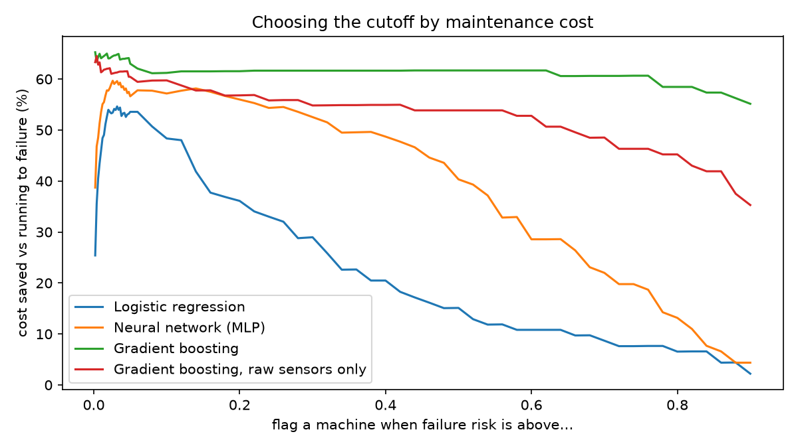

Predictive maintenance looks like a classification problem: will this machine fail soon, yes or
no? But the two kinds of mistake cost wildly different amounts:

| Event | Cost |
|---|---|
| Inspect a machine that turns out fine (false alarm) | $1,000 |
| Repair a failure caught in time | $10,000 |
| Replace a machine that fails unnoticed | $40,000 |

A miss costs **40× a false alarm**. These numbers are illustrative, but the shape is real, and it
changes how the model should be built and judged. This project rebuilds the ReneWind project from my
UT Austin Post-Graduate Program in AI & Machine Learning on an open dataset.
[Try the model](https://srikarbolleddu.com/projects/repair-prediction-system#demo) or
[read the code](https://github.com/srikarbolleddu/ml-repair-prediction).

## The data

[AI4I 2020](https://archive.ics.uci.edu/dataset/601/ai4i+2020+predictive+maintenance+dataset) has
10,000 machine readings, with a 3.4% failure rate. It's **synthetic**: generated by its author to
reflect real milling machines. Six inputs: product quality variant, air and process temperature,
rotational speed, torque and tool wear.

It also has five columns flagging *which kind* of failure happened (tool wear, heat dissipation,
power, overstrain, random). Those are only known after the failure, so using them would be target
leakage. They're dropped, and the API rejects them.

## Accuracy is the wrong scoreboard

Here's the final gradient-boosting model at two cutoffs, on 2,000 held-out machines:

| Cutoff | Accuracy | Failures caught | False alarms | Maintenance cost |
|---|---|---|---|---|
| 0.5 (the default) | **99.3%** | 56 of 68 | 2 | $1,042,000 |
| 0.003 (cost-optimal) | 92.5% | **64 of 68** | 146 | **$946,000** |

The default cutoff is more accurate and almost never cries wolf, but it misses 12 failures at
$40,000 each. The cost-optimal cutoff inspects 146 machines unnecessarily ($146,000) to catch 8 more
failures ($320,000 of replacements avoided). **The less accurate model saves $96,000 per 2,000
machines.**

So every model's cutoff is chosen to minimize total cost:

```python
def maintenance_cost(y_true, flagged):
    tn, fp, fn, tp = confusion_matrix(y_true, flagged, labels=[0, 1]).ravel()
    return fp * 1_000 + tp * 10_000 + fn * 40_000

def cheapest_threshold(y_true, p):
    # fine steps near zero: with a 40x miss penalty, the best cutoff is tiny
    grid = np.unique(np.concatenate([np.linspace(0.001, 0.05, 50), np.linspace(0.05, 0.99, 95)]))
    return min(grid, key=lambda t: maintenance_cost(y_true, p >= t))
```

A cutoff of 0.003 means "inspect any machine with more than a 0.3% chance of failing". That sounds
extreme, until you remember an inspection is 1/40th the price of a miss.



## Comparing models by money

I compared logistic regression, a neural network (scikit-learn's MLP) and gradient boosting, each at
its own cost-optimal cutoff:

| Model | Cost saved vs running to failure | Failures caught | PR-AUC |
|---|---|---|---|
| **Gradient boosting + physics features** | **65.2%** | 94% | **0.896** |
| Gradient boosting, raw sensors only | 63.3% | 91% | 0.855 |
| Neural network (MLP) + physics features | 58.4% | 90% | 0.668 |
| Logistic regression + physics features | 52.8% | 82% | 0.460 |

"Running to failure" means no model at all: every failure becomes a $40,000 replacement. Gradient
boosting wins clearly. Failures here happen in specific corners of the sensor space (high torque
*and* worn tools, high temperature *and* low speed), and trees find those interaction regions far
more easily than a linear model.

## Physics features

Three features computed from the readings with basic physics:

```python
out["power_w"] = out["torque_nm"] * out["rotational_speed_rpm"] * 2 * math.pi / 60
out["temp_diff_k"] = out["process_temp_k"] - out["air_temp_k"]
out["strain_min_nm"] = out["tool_wear_min"] * out["torque_nm"]
```

They encode how machines actually break: too much or too little power, heat that can't dissipate,
a worn tool under load. They raised gradient boosting's PR-AUC from 0.855 to 0.896, and in
permutation importance the temperature gap and wear × torque rank right behind rotational speed.

The same functions run at training time and inside the API, so a live request can't be computed
differently from the training data.

## The validation split that fooled me

My first version used the standard recipe: 60% train, 20% validation, 20% test, with every choice
made on validation. It picked the **raw-sensor** model.

Then the test set clearly preferred the physics-feature model, and I looked at why. The validation
set had 2,000 machines and only about **68 failures**. With a $40,000 penalty per miss, a handful
of borderline machines flips which model looks cheapest. The choice was noise.

The fix: use **5-fold cross-validation** on 80% of the data to make every choice (model,
hyperparameters, cutoff). Each of those 8,000 machines (about 270 failures) is scored by a model
that never saw it:

```python
oof = cross_val_predict(pipeline, x_dev, y_dev, cv=StratifiedKFold(5, shuffle=True), method="predict_proba")[:, 1]
t = cheapest_threshold(y_dev, oof)
```

Cross-validation independently picks the physics-feature model, at 65.7% savings, close to the test
result. One honest caveat: I changed the procedure *because* of what the test set showed, so the
test numbers are slightly optimistic. That's why I report the cross-validated number too, and why I
mention this at all.

The lesson: **with rare events, count your positives, not your rows.** 2,000 rows sounds like a lot.
68 failures isn't.

## What the model looks at

For every prediction, the demo resets each reading to a typical value and re-scores the machine.
The change in risk is that reading's contribution. A worn tool (216 minutes) under 57 Nm of torque
explains almost all of one machine's near-certain failure risk; overheating (a small gap between
process and air temperature) drives another.

Failure rates also show why tool wear matters: they stay between 2.2% and 2.9% until tools pass
200 minutes, then jump to **15.5%**.

## Takeaways

1. **Score models in money when mistakes cost different amounts.** The more accurate model was the
   more expensive one.
2. **Tune the cutoff to the costs.** At 40:1, inspecting at 0.3% risk is rational.
3. **Domain features beat model complexity.** Three lines of physics helped more than switching
   from a neural network to anything else.
4. **Count positives, not rows.** Make selection decisions with cross-validation when events are
   rare, and say so if the test set influenced you.

[Try the model](https://srikarbolleddu.com/projects/repair-prediction-system#demo) ·
[Read the code](https://github.com/srikarbolleddu/ml-repair-prediction)

*Project from the UT Austin Post-Graduate Program in AI & Machine Learning, rebuilt on the AI4I 2020
Predictive Maintenance dataset (Matzka, 2020; synthetic; CC BY 4.0).*
